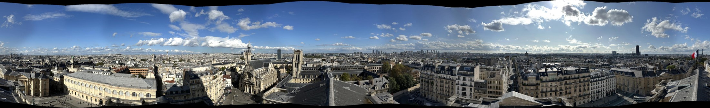

# Panorama Lab

## 🚀 快速开始

Python 3.10，Linux CPU：

```bash
git clone https://github.com/potatoQi/panorama-lab.git
cd panorama-lab
python3.10 -m venv .venv
source .venv/bin/activate
pip install -r requirements.lock -r requirements-xfeat.lock
pip install -e . --no-deps
python -m panorama.xfeat
panorama ui
```

打开 http://localhost:8501。命令行拼接：

```bash
panorama stitch /path/to/images --output runs/demo
```

## 🔬 复现实验

```bash
python scripts/datasets.py all --mirror
panorama benchmark data/hpatches.json --output runs/reproduce-hpatches
panorama benchmark data/udis-d.json --output runs/reproduce-udis-d
panorama benchmark data/apap.json --output runs/reproduce-apap
```

默认运行全部五种算法，并自动选择下表协议。`sift-plain` 是 SIFT，`sift` 是 RootSIFT；XFeat 使用官方预训练稀疏特征。

课程 28 张照片放入 `data/course/panorama/`：

```bash
for method in harris orb sift-plain sift xfeat; do
  panorama stitch data/course/panorama --feature "$method" --output "runs/reproduce-$method"
done
python scripts/report.py
```

## 📊 实验结果

<!-- RESULTS_START -->

<details>
<summary>实验设置</summary>

论文报告来自 [SuperPoint 2018，Table 4](https://arxiv.org/pdf/1712.07629)。公开评测设置对齐；原论文评测代码未公开，具体实现存在差异。

论文报告来自 [UDIS++ 2023，Table 1](https://arxiv.org/pdf/2302.08207)。测试集与指标口径对齐；匹配和图像变形实现不同。

</details>

### HPatches（完整 580 对，SuperPoint 2018 协议）

| 算法 | 来源 | H-Acc@1px ↑ | H-Acc@3px ↑ | H-Acc@5px ↑ | 估计成功 | 秒/对 ↓ |
| --- | --- | --- | --- | --- | --- | --- |
| Harris | 本地实测 | 42.8% | 73.6% | 80.7% | 580/580 | 0.59 |
| ORB | 本地实测 | 22.6% | 50.5% | 59.5% | 580/580 | 0.05 |
| SIFT | 本地实测 | 51.0% | 72.2% | 76.9% | 580/580 | 0.19 |
| RootSIFT | 本地实测 | 53.3% | 74.8% | 79.0% | 580/580 | 0.18 |
| XFeat | 本地实测 | 28.4% | 60.5% | 73.8% | 580/580 | 0.18 |
| ORB | 论文报告 | 15.0% | 39.5% | 53.8% | — | — |
| SIFT | 论文报告 | 42.4% | 67.6% | 75.9% | — | — |
| SuperPoint | 论文报告 | 31.0% | 68.4% | 82.9% | — | — |

### UDIS-D（完整测试集 1106 对，UDIS++ 2023 协议，失败用单位矩阵计分）

| 算法 | 来源 | PSNR (dB) ↑ | SSIM ↑ | 估计成功 | 秒/对 ↓ |
| --- | --- | --- | --- | --- | --- |
| Harris | 本地实测 | 23.06 | 0.767 | 1028/1106 | 0.67 |
| ORB | 本地实测 | 23.05 | 0.757 | 1058/1106 | 0.17 |
| SIFT | 本地实测 | 23.36 | 0.782 | 1056/1106 | 0.29 |
| RootSIFT | 本地实测 | 23.46 | 0.785 | 1062/1106 | 0.29 |
| XFeat | 本地实测 | 22.54 | 0.753 | 1012/1106 | 0.27 |
| SIFT + RANSAC | 论文报告 | 23.27 | 0.779 | — | — |
| APAP | 论文报告 | 23.79 | 0.794 | — | — |
| UDIS++ | 论文报告 | 25.43 | 0.838 | — | — |

### APAP（补充实验：完整 27 对相邻图像，非原论文 RMSE 协议）

| 算法 | 来源 | Overlap PSNR (dB) ↑ | Overlap SSIM ↑ | 估计成功 | 秒/对 ↓ |
| --- | --- | --- | --- | --- | --- |
| Harris | 本地实测 | 19.10 | 0.610 | 26/27 | 0.98 |
| ORB | 本地实测 | 18.88 | 0.586 | 26/27 | 0.28 |
| SIFT | 本地实测 | 19.18 | 0.621 | 27/27 | 0.43 |
| RootSIFT | 本地实测 | 19.20 | 0.627 | 27/27 | 0.43 |
| XFeat | 本地实测 | 18.69 | 0.588 | 27/27 | 0.41 |

### 课程全景（28 张）

| 特征 | 拼接图片数 | 尺寸 (px) | 耗时 (s) ↓ |
| --- | --- | --- | --- |
| Harris（手写） | 28/28 | 6021 × 917 | 82.0 |
| ORB | 28/28 | 5993 × 941 | 117.0 |
| SIFT | 28/28 | 5950 × 913 | 126.0 |
| RootSIFT | 28/28 | 5956 × 914 | 72.6 |
| XFeat | 28/28 | 6199 × 928 | 74.1 |



<!-- RESULTS_END -->

许可证：[MIT](LICENSE)；内置 XFeat 代码遵循 [Apache-2.0](src/panorama/_vendor/xfeat/LICENSE)。
